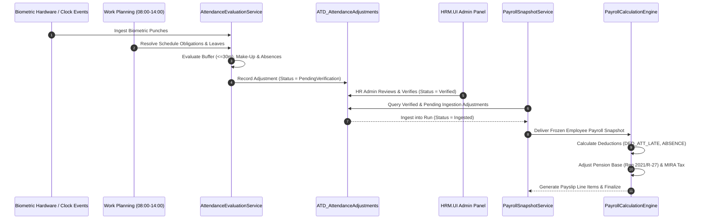

# Maldives Civil Service Attendance Deductions and Payroll Integration
## Enterprise Technical & Regulatory Specification Document

**System:** Digital HR (DHR)  
**Modules:** Attendance Reconciliation, Work Planning, Leave Management & Enterprise Payroll  
**Technology Stack:** .NET 8, Blazor Server, EF Core, SQL Server, Tailwind CSS  
**Target Architecture:** Segment-based reconciliation, effective-dated policy engine, circuit-authenticated API transport, and idempotent payroll snapshot engine.

---

## 1. Regulatory Framework & Official Citations

All attendance outcome deductions and downstream payroll adjustments adhere strictly to official Maldivian employment and tax statutes.

```
+---------------------------------------------------------------------------------------------------+
|                                  MALDIVIAN REGULATORY CITATIONS                                   |
+------------------------------------+-------------------------------------+------------------------+
| Authority / Source                 | Provision / Article                 | Legal Effect           |
+------------------------------------+-------------------------------------+------------------------+
| Civil Service Commission (CSC)     | Article 149                         | Salary calculation     |
|                                    |                                     | divisor = 30 days      |
| Civil Service Commission (CSC)     | Article 160(a)                      | Lateness & absence     |
|                                    |                                     | deduction formulas     |
| Civil Service Commission (CSC)     | July 2026 Policy Circular           | 30-min arrival buffer  |
|                                    |                                     | & weekly make-up rules |
| Maldives Pension Office (MPO)      | Regulation 2021/R-27                | Pensionable base net of|
|                                    |                                     | basic attendance ded.  |
| Maldives Inland Revenue Authority  | Income Tax Act (Withholding Tax)   | Taxable base net of    |
| (MIRA)                             |                                     | ded. & pension         |
+------------------------------------+-------------------------------------+------------------------+
```

### 1.1 Civil Service Regulation Article 149 (Salary Basis)
- Standard salary divisor is fixed at **30 days** across all calendar months regardless of the actual calendar length (28, 29, 30, or 31 days).
- Official daily working minutes for standard non-shift civil service roles: **360 minutes** (6 hours per day).
- Per-minute salary rate formula:
  $$\text{Daily Salary} = \frac{\text{Monthly Basic Salary}}{30}$$
  $$\text{Per-Minute Rate} = \frac{\text{Daily Salary}}{\text{Official Daily Working Minutes (360)}}$$

### 1.2 Civil Service Regulation Article 160(a) (Lateness & Absence Deductions)
- **Late Attendance**: Deductible minutes multiplied by the per-minute salary rate:
  $$\text{Late Deduction} = \text{Per-Minute Rate} \times \text{Approved Deductible Minutes}$$
- **Full-Day Unauthorised Absence**: Covers both daily basic salary and applicable monthly service allowance:
  $$\text{Full-Day Absence Deduction} = \frac{\text{Monthly Basic Salary}}{30} + \frac{\text{Applicable Monthly Service Allowance}}{30}$$
  *Note:* General allowances (such as phone or uniform allowances) are excluded from absence deductions unless explicitly mandated by individual ministerial employment contracts.

### 1.3 July 2026 Civil Service 30-Minute Arrival Buffer
- **Policy Purpose**: Introduces flexibility for standard office employees arriving up to 30 minutes past the official schedule start (e.g., arrival between 08:00 and 08:30 for an 08:00 start).
- **Make-Up Window**: Employees must complete make-up working time within the authorized window (`SameWeek`).
- **Buffer Exceeded Guard**: The rule governing arrivals beyond 30 minutes (e.g. 31 minutes late) is configurable via `BufferExceededRule`:
  - `RequireReview` (*Default*): Flags the record for administrative verification rather than making hardcoded statutory assumptions.
  - `DeductAllMinutes`: Deducts the entire elapsed duration (e.g., 31 minutes).
  - `DeductExcessOnly`: Deducts only minutes exceeding the buffer (e.g., $31 - 30 = 1$ minute).

### 1.4 Maldives Pension Office Regulation 2021/R-27
- Basic salary deductions resulting from late attendance or unauthorized absence directly reduce the pensionable basic wage.
- The 7% employee pension deduction and 7% employer statutory contribution are calculated on the **adjusted base**:
  $$\text{Adjusted Basic Salary} = \max(0, \text{Basic Salary} - \text{Basic Attendance Deductions})$$
  $$\text{Pensionable Base} = \text{Adjusted Basic Salary} + \text{Pensionable Allowances}$$
  $$\text{Employee Pension (7\%)} = \text{round}(\text{Pensionable Base} \times 0.07, 2)$$
  $$\text{Employer Pension (7\%)} = \text{round}(\text{Pensionable Base} \times 0.07, 2)$$

### 1.5 MIRA Employee Withholding Tax
- Net taxable income considers earnings after deducting qualifying attendance adjustments and employee statutory pension:
  $$\text{Taxable Remuneration} = \max(0, \text{Gross Taxable} - \text{Attendance Deductions} - \text{Employee Pension})$$
  $$\text{Taxable Excess} = \max(0, \text{Taxable Remuneration} - 60,000.00)$$
  $$\text{Withholding Tax (5\%)} = \text{round}(\text{Taxable Excess} \times 0.05, 2)$$

---

## 2. Solution Architecture & Reconciliation Flow



---

## 3. Database Schema Specification

In strict compliance with `Database/Scripts/TableNaming.md`, all physical database objects use the uppercase prefix **`ATD_`**.

### 3.1 `ATD_AttendanceDeductionPolicies`
Stores effective-dated legal calculation policies per organisation:
```sql
CREATE TABLE [dbo].[ATD_AttendanceDeductionPolicies] (
    [AttendanceDeductionPolicyId] BIGINT IDENTITY(1,1) NOT NULL,
    [OrganisationId] INT NOT NULL,
    [PolicyCode] NVARCHAR(64) NOT NULL,
    [PolicyName] NVARCHAR(256) NOT NULL,
    [LegalReference] NVARCHAR(512) NOT NULL,
    [EffectiveFrom] DATE NOT NULL,
    [EffectiveTo] DATE NULL,
    [IsActive] BIT NOT NULL CONSTRAINT [DF_ATD_Policies_IsActive] DEFAULT (1),
    [IsVerified] BIT NOT NULL CONSTRAINT [DF_ATD_Policies_IsVerified] DEFAULT (1),
    [SalaryDivisor] INT NOT NULL CONSTRAINT [DF_ATD_Policies_Divisor] DEFAULT (30),
    [OfficialMinutesSource] NVARCHAR(64) NOT NULL CONSTRAINT [DF_ATD_Policies_Source] DEFAULT ('ScheduledWorkPlan'),
    [DefaultDailyWorkingMinutes] INT NOT NULL CONSTRAINT [DF_ATD_Policies_Minutes] DEFAULT (360),
    [ArrivalBufferMinutes] INT NOT NULL CONSTRAINT [DF_ATD_Policies_Buffer] DEFAULT (30),
    [BufferEligibilityCategory] NVARCHAR(64) NOT NULL CONSTRAINT [DF_ATD_Policies_BufferCat] DEFAULT ('AllNonShift'),
    [BufferMakeUpRequired] BIT NOT NULL CONSTRAINT [DF_ATD_Policies_MakeUpReq] DEFAULT (1),
    [BufferMakeUpWindow] NVARCHAR(64) NOT NULL CONSTRAINT [DF_ATD_Policies_MakeUpWin] DEFAULT ('SameWeek'),
    [BufferExceededRule] NVARCHAR(64) NOT NULL CONSTRAINT [DF_ATD_Policies_ExceededRule] DEFAULT ('RequireReview'),
    [LateDeductionFormula] NVARCHAR(64) NOT NULL CONSTRAINT [DF_ATD_Policies_LateForm] DEFAULT ('PerMinuteBasic'),
    [AbsenceDeductionFormula] NVARCHAR(64) NOT NULL CONSTRAINT [DF_ATD_Policies_AbsForm] DEFAULT ('BasicPlusServiceAllowance'),
    [DeductServiceAllowanceOnAbsence] BIT NOT NULL CONSTRAINT [DF_ATD_Policies_DedServ] DEFAULT (1),
    [ServiceAllowanceComponentCode] NVARCHAR(64) NOT NULL CONSTRAINT [DF_ATD_Policies_ServCode] DEFAULT ('SERV_ALLOW'),
    [DeductFromPensionableSalary] BIT NOT NULL CONSTRAINT [DF_ATD_Policies_DedPens] DEFAULT (1),
    [RoundingMethod] NVARCHAR(32) NOT NULL CONSTRAINT [DF_ATD_Policies_Rounding] DEFAULT ('AwayFromZero'),
    [RequiresVerification] BIT NOT NULL CONSTRAINT [DF_ATD_Policies_ReqVerif] DEFAULT (1),
    [ApprovedByUserId] INT NULL,
    [ApprovedAtUtc] DATETIME2 NULL,
    [CreatedAtUtc] DATETIME2 NOT NULL CONSTRAINT [DF_ATD_Policies_Created] DEFAULT (SYSUTCDATETIME()),
    [UpdatedAtUtc] DATETIME2 NOT NULL CONSTRAINT [DF_ATD_Policies_Updated] DEFAULT (SYSUTCDATETIME()),
    CONSTRAINT [PK_ATD_AttendanceDeductionPolicies] PRIMARY KEY CLUSTERED ([AttendanceDeductionPolicyId] ASC)
);
CREATE NONCLUSTERED INDEX [IX_ATD_AttendanceDeductionPolicies_Org_Dates] 
ON [dbo].[ATD_AttendanceDeductionPolicies] ([OrganisationId], [EffectiveFrom], [EffectiveTo]);
```

### 3.2 `ATD_AttendanceAdjustments`
Bridge table linking Attendance Reconciliation with Enterprise Payroll:
```sql
CREATE TABLE [dbo].[ATD_AttendanceAdjustments] (
    [AttendanceAdjustmentId] BIGINT IDENTITY(1,1) NOT NULL,
    [OrganisationId] INT NOT NULL,
    [IndividualId] INT NOT NULL,
    [JobId] INT NOT NULL,
    [WorkDate] DATE NOT NULL,
    [AdjustmentType] NVARCHAR(64) NOT NULL,
    [ScheduledMinutes] INT NOT NULL,
    [ActualMinutes] INT NOT NULL,
    [DeductibleMinutes] INT NOT NULL,
    [EstimatedDeductionAmount] DECIMAL(18,4) NOT NULL,
    [BasicSalaryDeductionAmount] DECIMAL(18,4) NOT NULL,
    [ServiceAllowanceDeductionAmount] DECIMAL(18,4) NOT NULL,
    [SourceAttendanceReference] NVARCHAR(128) NOT NULL,
    [SourceObligationId] BIGINT NULL,
    [AttendanceOutcome] NVARCHAR(64) NOT NULL,
    [VerificationStatus] NVARCHAR(64) NOT NULL CONSTRAINT [DF_ATD_Adj_VerStatus] DEFAULT ('PendingVerification'),
    [VerifiedByUserId] INT NULL,
    [VerifiedAtUtc] DATETIME2 NULL,
    [ReviewerComments] NVARCHAR(1024) NULL,
    [PolicyId] BIGINT NOT NULL,
    [PolicyCode] NVARCHAR(64) NOT NULL,
    [PolicyVersion] NVARCHAR(64) NOT NULL,
    [RegulatorySource] NVARCHAR(256) NOT NULL,
    [IsRegulatoryAssumptionVerified] BIT NOT NULL CONSTRAINT [DF_ATD_Adj_RegVerif] DEFAULT (1),
    [PayrollProcessingStatus] NVARCHAR(64) NOT NULL CONSTRAINT [DF_ATD_Adj_PayStatus] DEFAULT ('Pending'),
    [PayrollRunId] INT NULL,
    [PayrollEmployeeId] INT NULL,
    [PayrollLineId] INT NULL,
    [CreatedAtUtc] DATETIME2 NOT NULL CONSTRAINT [DF_ATD_Adj_Created] DEFAULT (SYSUTCDATETIME()),
    [UpdatedAtUtc] DATETIME2 NOT NULL CONSTRAINT [DF_ATD_Adj_Updated] DEFAULT (SYSUTCDATETIME()),
    CONSTRAINT [PK_ATD_AttendanceAdjustments] PRIMARY KEY CLUSTERED ([AttendanceAdjustmentId] ASC)
);

-- Strict Idempotency & Duplicate Prevention Index
CREATE UNIQUE NONCLUSTERED INDEX [UX_ATD_AttendanceAdjustments_Org_Job_Date_Type]
ON [dbo].[ATD_AttendanceAdjustments] ([OrganisationId], [JobId], [WorkDate], [AdjustmentType])
WHERE [VerificationStatus] <> 'Cancelled';
```

### 3.3 `ATD_AttendanceExceptionReviews`
Immutable audit log tracking every administrative action:
```sql
CREATE TABLE [dbo].[ATD_AttendanceExceptionReviews] (
    [AttendanceExceptionReviewId] BIGINT IDENTITY(1,1) NOT NULL,
    [AttendanceAdjustmentId] BIGINT NOT NULL,
    [OrganisationId] INT NOT NULL,
    [Action] NVARCHAR(64) NOT NULL, -- 'Verify', 'Excuse', 'Reject', 'Reopen'
    [Reason] NVARCHAR(1024) NOT NULL,
    [PerformedByUserId] INT NOT NULL,
    [PerformedAtUtc] DATETIME2 NOT NULL CONSTRAINT [DF_ATD_Reviews_Date] DEFAULT (SYSUTCDATETIME()),
    [PreviousStatus] NVARCHAR(64) NOT NULL,
    [NewStatus] NVARCHAR(64) NOT NULL,
    CONSTRAINT [PK_ATD_AttendanceExceptionReviews] PRIMARY KEY CLUSTERED ([AttendanceExceptionReviewId] ASC),
    CONSTRAINT [FK_ATD_ExceptionReviews_Adjustments] FOREIGN KEY ([AttendanceAdjustmentId])
        REFERENCES [dbo].[ATD_AttendanceAdjustments] ([AttendanceAdjustmentId]) ON DELETE CASCADE
);
```

---

## 4. UI Architecture & The 401 Unauthorized Resolution

### 4.1 Root Cause of the Initial 401 Error
When interacting with `/admin/payroll/payroll?tab=attendance` as user **Ahmed Afzal**, a `401 Unauthorized` was encountered:
1. `AttendanceDeductionClient` previously requested an instance via `IHttpClientFactory.CreateClient("backend")`.
2. In `HRM.UI/Program.cs`, the `"backend"` client uses `SocketsHttpHandler` with `UseCookies = false` and possesses **no session cookies**.
3. All controllers derived from `HrmApiController` demand cookie authentication:
   ```csharp
   [Authorize(AuthenticationSchemes = CookieAuthenticationDefaults.AuthenticationScheme)]
   [ServiceFilter(typeof(ApiSessionFilter))]
   public abstract class HrmApiController : ControllerBase;
   ```
4. Without the user's session cookie jar, the request failed cookie authorization and the `ApiSessionFilter` employee context check.

### 4.2 The Solution: Circuit-Scoped Authenticated Transport
The client was registered in [`HRM.UI/Services/Transport/ApiClientRegistration.cs`](file:///g:/NewEadmin/WebApp/HRM/HRM.UI/Services/Transport/ApiClientRegistration.cs) to use the authenticated `CircuitBackendHandler`:
```csharp
services.AddScoped<AttendanceDeductionClient>(provider =>
{
    var origins = provider.GetRequiredService<BackendOrigins>();
    var handler = new CircuitBackendHandler(
        provider.GetRequiredService<AuthenticationStateProvider>(),
        provider.GetRequiredService<BackendSessionStore>(),
        provider.GetRequiredService<IHttpClientFactory>(),
        origins,
        provider.GetRequiredService<IDataProtectionProvider>(),
        provider.GetRequiredService<ILogger<BackendSession>>());
    var client = new HttpClient(handler) { BaseAddress = origins.Api };
    return new AttendanceDeductionClient(client);
});
```
This guarantees:
- **Automatic Cookie Propagation**: The circuit user's authenticated cookie container is attached to every outbound request.
- **Automated Anti-Forgery Tokens**: For state-altering operations (`Verify`, `Excuse`, `Reject`, `EvaluateRange`), `BackendSession.SendAsync` fetches and attaches `X-CSRF-TOKEN`.
- **Dynamic Organisation Scoping**: `AttendanceDeductionController` resolves `organisationId` from `IUserAccessService` when not explicitly supplied, ensuring users like Ahmed Afzal are automatically scoped to their authorized organization.

---

## 5. Verification Matrix (26 Tested Scenarios)

The test suite in [`Tests/HRM.Api.UnitTests/MaldivesAttendanceDeductionTests.cs`](file:///g:/NewEadmin/WebApp/HRM/Tests/HRM.Api.UnitTests/MaldivesAttendanceDeductionTests.cs) validates all regulatory requirements:

| # | Test Method Name | Regulatory Requirement | Test Result |
|---|---|---|:---:|
| 1 | `Scenario01_OnTimeArrival` | Scheduled 08:00, arrival 07:58 -> DeductibleMinutes = 0 | **PASS** |
| 2 | `Scenario02_TenMinuteBuffer` | Arrival 08:10 within 30m buffer -> Pending make-up | **PASS** |
| 3 | `Scenario03_TwentyMinuteBuffer_WithCompletedMakeUp` | Completed make-up time -> DeductibleMinutes = 0 | **PASS** |
| 4 | `Scenario04_ThirtyMinuteBufferBoundary` | Arrival 08:30 boundary -> Qualified for make-up | **PASS** |
| 5 | `Scenario05_ThirtyOneMinuteArrival` | Arrival > 30m handled per policy rule (`RequireReview`) | **PASS** |
| 6 | `Scenario06_BufferWithIncompleteMakeUp` | Make-up window expired incomplete -> Converted to lateness | **PASS** |
| 7 | `Scenario07_ExcludedShiftWorkerLateness` | Shift workers excluded from buffer -> Deducts full lateness | **PASS** |
| 8 | `Scenario08_ApprovedAttendanceExemption` | Approved transport exemption -> Late_Excused (0 deduction) | **PASS** |
| 9 | `Scenario09_EarlyDeparture` | Departure 30m prior to end -> EarlyDeparture calculated | **PASS** |
| 10 | `Scenario10_FullDayUnauthorisedAbsence` | Article 160(a): Basic/30 + Service Allowance/30 | **PASS** |
| 11 | `Scenario11_ApprovedPaidLeave` | Approved annual/sick leave suppresses absence deduction | **PASS** |
| 12 | `Scenario12_ApprovedUnpaidLeave` | Unpaid leave tracked via leave items, not punitive absence | **PASS** |
| 13 | `Scenario13_OfficialDuty` | Approved off-site work satisfies daily work plan | **PASS** |
| 14 | `Scenario14_MissingClockEvent` | Missing punch flags `MissingClockEvent`, not absence | **PASS** |
| 15 | `Scenario15_BiometricClockCorrection` | Approved clock correction resolves pending exception | **PASS** |
| 16 | `Scenario16_PartialDayAbsence` | 120m absence during core official hours calculated | **PASS** |
| 17 | `Scenario17_OverlappingDutySegments` | Official duty + additional duty overlap does not double count | **PASS** |
| 18 | `Scenario18_BasicSalaryLatenessDeduction` | `PayrollCalculationEngine` emits `DED_ATT_LATE` | **PASS** |
| 19 | `Scenario19_FullDayAbsenceDeduction` | Emits `DED_ATT_ABSENCE_BASIC` and `DED_ATT_ABSENCE_SERV` | **PASS** |
| 20 | `Scenario20_PensionOfficeRegulation2021R27` | Basic deduction reduces pensionable wage before 7% rate | **PASS** |
| 21 | `Scenario21_MIRA_EmployeeWithholdingTax` | Taxable income calculated net of attendance ded. & pension | **PASS** |
| 22 | `Scenario22_DuplicateAdjustmentPrevention` | Unique index enforces strict idempotency | **PASS** |
| 23 | `Scenario23_LateApprovalPostFinalisationLock` | Finalized / Paid payroll runs lock adjustment items | **PASS** |
| 24 | `Scenario24_MidMonthTransfer` | Effective-dated salary applied for date of occurrence | **PASS** |
| 25 | `Scenario25_HistoricalEffectiveDate` | Respects policies active on historical work dates | **PASS** |
| 26 | `Scenario26_MultiOrganisationConcurrency` | Concurrency isolation across distinct organisations | **PASS** |

---

## 6. Deployment & Administrative Runbook

1. **Database Schema Application**:
   Execute the migration script [`20261108110000_MaldivesCivilServiceAttendanceDeductions.cs`](file:///g:/NewEadmin/WebApp/HRM/HRM.Api/Migrations/20261108110000_MaldivesCivilServiceAttendanceDeductions.cs).
2. **Accessing the Panel**:
   Navigate to `/admin/payroll/payroll` and select the **"Attendance Deductions"** tab.
3. **Daily Administrative Workflow**:
   - Filter by date range and select `PendingVerification`.
   - Click **Verify** to clear an item for payroll snapshot inclusion.
   - Click **Excuse** to waive deductible minutes (e.g. approved ferry delays or verified medical excuses).
   - Click **Reject** to dismiss false exception claims.
4. **Payroll Cutoff Ingestion**:
   During creation of a new payroll period or run snapshot, [`PayrollSnapshotService`](file:///g:/NewEadmin/WebApp/HRM/HRM.Api/Services/Payroll/PayrollSnapshotService.cs) automatically collects all records having `VerificationStatus = 'Verified'` and updates them to `PayrollProcessingStatus = 'Ingested'`, ensuring deterministic and immutable compensation calculations.
