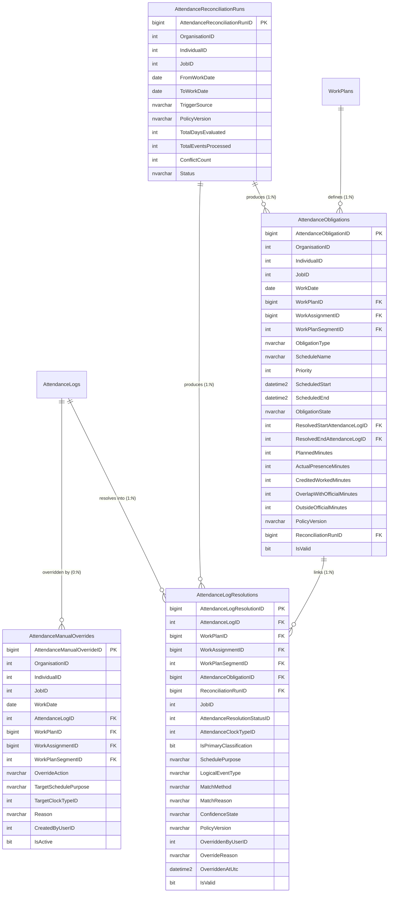

# Attendance Reconciliation Architecture, Rule Specification & Database Design

## Phase 1 — Root-Cause Architecture Audit & End-to-End Event Trace

### 1.1 End-to-End Clock Event Trace
1. **Raw Clock Event Retrieval (`AttendanceLogs`)**:
   - Physical biometric and online clock punches are stored in `AttendanceLogs` (`AttendanceLogId`, `IndividualId`, `OrganisationId`, `Date`, `InOutModeId`, `ActualInOutMode`, `AttendanceLogModeId`, `AttendanceLogStateId`).
   - Online clock punches set `AttendanceLogModeId = 2` and `InOutModeId = 3` (automatic direction), whereas terminal punches supply `InOutModeId` / `ActualInOutMode` (`1 = CheckIn`, `2 = CheckOut`, `3 = BreakOut`, `4 = BreakIn`).
2. **Work Plan Generation (`WorkPlanGenerator` / `WorkPlans` / `WorkAssignments` / `WorkPlanSegments`)**:
   - Approved `WorkTemplates`, `JobWorkTemplates`, and `DutyRosters` materialize into a daily `WorkPlan` with `WorkAssignments` (`SchedulePurpose = "Official"` or `"Duty"`) and `WorkPlanSegments` (`CHECK_IN`, `CHECK_OUT`, `DUTY_CHECK_IN`, `DUTY_CHECK_OUT`, `BREAK_START`, `BREAK_END`, `LUNCH`, `WORK`).
3. **Resolution & Persistence (`AttendanceWorkPlanResolver`, `AttendanceLogProcessor`, `AttendanceLogResolutionRepository`)**:
   - Previously, `AttendanceWorkPlanResolver` selected a single winning `BoundaryCandidate` per punch, and `AttendanceLogResolutionRepository.CreateAsync` invalidated **all** existing active `AttendanceLogResolutions` for an `AttendanceLogId` (`UX_AttendanceLogResolutions_ActiveAttendanceLog` enforced a 1:1 constraint between `AttendanceLogId` and active `AttendanceLogResolution`).
4. **Daily Evaluation & UI Rendering (`AttendanceEvaluationService`, `AttendanceLogDataLoader`, `DutyClockEventPresentation`, `AttendanceScheduleFacts`, `AttendanceService`, `HRM.UI`)**:
   - Because each physical punch could only hold one active `AttendanceLogResolution`, a punch at `12:30` that matched a `10:00–12:00` Duty's delayed check-out was exclusively consumed by the Duty obligation (`WorkAssignmentId = Duty`) or, in fallback UI queries (`MyAttendanceGrid.razor`), any `AttendanceClockTypeId = 2` was treated as the employee's final Official check-out.

### 1.2 Five Architectural Root Causes Identified and Corrected
1. **Single-Resolution Constraint (`UX_AttendanceLogResolutions_ActiveAttendanceLog`)**:
   - *Before*: Filtered unique index `WHERE [IsValid] = 1` on `(AttendanceLogID)` prevented one physical clock event from simultaneously satisfying two obligations (e.g., Official Break Out + Duty Check-Out, or Official Check-In + coincident Duty Check-In).
   - *After*: Replaced with `UX_AttendanceLogResolutions_ActivePrimaryPerLog` (`WHERE [IsValid] = 1 AND [IsPrimaryClassification] = 1`) and `UX_AttendanceLogResolutions_ActiveSegmentPerLog` (`WHERE [IsValid] = 1 AND [WorkPlanSegmentID] IS NOT NULL`).
2. **Duty Consuming Official Events**:
   - *Before*: `AttendanceWorkPlanResolver` prioritized open duty check-outs over official break/lunch windows and returned only a single resolution without secondary associations.
   - *After*: Official Working Schedule (`Priority = 1`) is evaluated first for primary classification (`IsPrimaryClassification = true`), while eligible shared events also produce secondary associations (`IsPrimaryClassification = false`) for Duty (`Priority = 10+`) or Official Break (`Priority = 2`).
3. **Duty Duration Inflation**:
   - *Before*: Delayed duty check-out punches (e.g., `12:30` for a `10:00–12:00` duty) could inflate duty worked duration to `150` minutes (`10:00–12:30`).
   - *After*: Actual presence (`150` min) is recorded separately from credited duty duration, which is strictly clamped to `[max(ScheduledStart, ActualStart), min(ScheduledEnd, ActualEnd)]` (`120` min) unless an approved overtime/extension exists.
4. **Lack of First-Class Obligation State Tracking**:
   - *Before*: No persistent obligation table tracked Official, Official Break, and Duty obligations independently per employee-day.
   - *After*: Added `AR_AttendanceObligations`, `AR_AttendanceReconciliationRuns`, and `AR_AttendanceManualOverrides`.
5. **UI Conflation of Duty Exit / Break Out with Official Check-Out**:
   - *Before*: `MyAttendanceGrid.razor` selected any `AttendanceClockTypeId == 2` as `ClockOut`, and `TodaysAttendanceStatusCard.razor` did not separate Official Schedule state (`OnBreak`, `MissingClockOut`) from Additional Duties.
   - *After*: Updated all `HRM.UI` attendance components to separate Official Schedule, Official Breaks, Additional Duties, Shared Events, and Planned vs Actual vs Credited durations.

---

## Phase 2 — Deterministic Reconciliation Rule Specification

### 2.1 Obligation Priority Hierarchy
| Priority Rank | Obligation Type | `SchedulePurpose` | Rule |
| :--- | :--- | :--- | :--- |
| **1 (Highest)** | Official Working Schedule | `Official` | Always takes primary classification (`IsPrimaryClassification = true`) when eligible. Never shortened, terminated, or replaced by a Duty. |
| **2** | Official Break / Lunch | `OfficialBreak` | Managed within the Official Working Schedule. |
| **10+** | Additional Duty / Shift Duty | `Duty` | Independent logical state (`NotStarted`, `ClockedIn`, `Completed`, `MissingClockIn`, `MissingClockOut`, `Conflict`). Can share physical events with Official or Break obligations when policy allows. |

### 2.2 Seven-Step Matching Priority Hierarchy
1. **Active Audited Manual Override (`AR_AttendanceManualOverrides`)**: Explicit HR override with mandatory reason.
2. **Explicit Trustworthy Device Direction**: Physical terminal direction (`CheckIn = 1`, `CheckOut = 2`, `BreakOut = 3 -> 4`, `BreakIn = 4 -> 5`) when `AttendanceLogModeId != 2`.
3. **Official Schedule Entry, Break, and Exit Windows**: Official Check-In (`[-GraceBefore, +LateWindow]`), Official Break (`[BreakStart - Grace, BreakEnd + Grace]`), and Official Check-Out (`[ScheduledEnd - EarlyGrace, ScheduledEnd + LateOutWindow]`).
4. **Approved Additional Duty Entry and Exit Windows**: Evaluated against each Duty obligation's independent state.
5. **Policy-Supported Shared Event Rules**:
   - **Coincident Start (`08:00` Official + `08:00` Duty)**: A single `08:00` punch resolves as Primary `OfficialCheckIn` and Secondary `DutyCheckIn` unless a separate dedicated punch exists.
   - **Coincident End (`14:00` Official + `12:00–14:00` Duty)**: A single `14:00` punch resolves as Primary `OfficialCheckOut` and Secondary `DutyCheckOut`.
   - **Delayed Duty Exit + Official Break (`10:00–12:00` Duty + `12:00–13:00` Official Break with `12:30` Punch)**: The `12:30` punch resolves as Primary `OfficialBreakOut` (`IsPrimaryClassification = true`) and Secondary `DutyCheckOut` (`IsPrimaryClassification = false`), clamping credited duty duration to `120` minutes (`10:00–12:00`) and keeping Official Schedule in `OnBreak` / `MissingClockOut` (never completed at `12:30`).
6. **Duplicate / Noisy Event Suppression**: Punches within `DefaultDuplicateSuppressionSeconds` (`120s`) with the same effective direction are marked `DuplicateIgnored` (`AttendanceResolutionStatusIds.DuplicatePunch = 11`).
7. **Unresolved Conflict / Exception**: Ambiguous punches (e.g., two overlapping duties with identical `10:00` start and only one punch, or out-of-window punches) are never guessed; they are flagged with `ConfidenceState = "Conflict"` (`AttendanceResolutionStatusIds.Conflict = 12`).

---

## Phase 3 — Database Schema Design

### 3.1 Entity-Relationship Diagram

### 3.2 Field-Level Table Specifications

#### 1. `AttendanceLogResolutions` (Enhanced Multi-Association Resolution Table)
- **Filtered Unique Indexes**:
  - `UX_AttendanceLogResolutions_ActivePrimaryPerLog` ON `([AttendanceLogID]) WHERE [IsValid] = 1 AND [IsPrimaryClassification] = 1` (guarantees at most 1 active primary classification per raw event).
  - `UX_AttendanceLogResolutions_ActiveSegmentPerLog` ON `([AttendanceLogID], [WorkPlanSegmentID]) WHERE [IsValid] = 1 AND [WorkPlanSegmentID] IS NOT NULL` (allows multiple distinct segment associations per raw event while preventing duplicate links to the same segment).
- **New Columns**:
  - `IsPrimaryClassification` (`bit NOT NULL DEFAULT 1`)
  - `SchedulePurpose` (`nvarchar(40) NULL`: `'Official'`, `'OfficialBreak'`, `'Duty'`)
  - `LogicalEventType` (`nvarchar(60) NULL`: `'OfficialCheckIn'`, `'OfficialCheckOut'`, `'OfficialBreakOut'`, `'OfficialBreakIn'`, `'DutyCheckIn'`, `'DutyCheckOut'`, `'DuplicateIgnored'`, `'UnmatchedException'`)
  - `MatchMethod` (`nvarchar(60) NULL`: `'DeviceDirection'`, `'OfficialBoundaryWindow'`, `'OfficialBreakWindow'`, `'DutyBoundaryWindow'`, `'DelayedDutyExitWindow'`, `'SharedCoincidentBoundary'`, `'ManualOverride'`)
  - `MatchReason` (`nvarchar(500) NULL`)
  - `ConfidenceState` (`nvarchar(40) NOT NULL DEFAULT 'Deterministic'`)
  - `PolicyVersion` (`nvarchar(40) NOT NULL DEFAULT 'v2.0-OfficialPriority'`)
  - `ReconciliationRunID` (`bigint NULL` FK -> `AR_AttendanceReconciliationRuns`)
  - `AttendanceObligationID` (`bigint NULL` FK -> `AR_AttendanceObligations`)
  - `OverriddenByUserID` (`int NULL`), `OverrideReason` (`nvarchar(500) NULL`), `OverriddenAtUtc` (`datetime2 NULL`)

#### 2. `AR_AttendanceObligations`
Stores each planned obligation (`Official`, `OfficialBreak`, `Duty`) per employee-day along with its independent state (`ObligationState`), matched start/end `AttendanceLogID`s, and `PlannedMinutes`, `ActualPresenceMinutes`, `CreditedWorkedMinutes`, `OverlapWithOfficialMinutes`, and `OutsideOfficialMinutes`.

#### 3. `AR_AttendanceReconciliationRuns`
Stores audit metadata for single-day and batch historical reconciliation runs (`TriggerSource`, `PolicyVersion`, `FromWorkDate`, `ToWorkDate`, `TotalDaysEvaluated`, `TotalEventsProcessed`, `ConflictCount`, `Status`).

#### 4. `AR_AttendanceManualOverrides`
Stores immutable HR manual overrides (`OverrideAction`, `TargetSchedulePurpose`, `TargetClockTypeID`, mandatory `Reason`, `CreatedByUserID`, `CreatedAtUtc`, `SupersededByOverrideID`).

### 3.3 Sample Persisted Rows (`08:00–14:00` Official + `12:00–13:00` Official Break + `10:00–12:00` Duty, Punches at `08:00`, `10:00`, `12:30`)

#### `AttendanceLogs` (Immutable Physical Records)
| `AttendanceLogID` | `Date` | `InOutModeID` | `AttendanceLogModeID` |
| :--- | :--- | :--- | :--- |
| `1001` | `2026-11-03 08:00:00` | `3` (Auto) | `2` (Online) |
| `1002` | `2026-11-03 10:00:00` | `3` (Auto) | `2` (Online) |
| `1003` | `2026-11-03 12:30:00` | `3` (Auto) | `2` (Online) |

#### `AttendanceLogResolutions` (4 Active Rows for 3 Physical Events)
| `AttendanceLogID` | `IsPrimaryClassification` | `SchedulePurpose` | `LogicalEventType` | `AttendanceClockTypeID` | `MatchMethod` |
| :--- | :--- | :--- | :--- | :--- | :--- |
| `1001` (`08:00`) | `1` (`true`) | `Official` | `OfficialCheckIn` | `1` (`CheckIn`) | `OfficialBoundaryWindow` |
| `1002` (`10:00`) | `1` (`true`) | `Duty` | `DutyCheckIn` | `1` (`CheckIn`) | `DutyBoundaryWindow` |
| `1003` (`12:30`) | `1` (`true`) | `OfficialBreak` | `OfficialBreakOut` | `4` (`BreakOut`) | `OfficialBreakWindow` |
| `1003` (`12:30`) | `0` (`false`) | `Duty` | `DutyCheckOut` | `2` (`CheckOut`) | `DelayedDutyExitWindow` |

#### `AR_AttendanceObligations`
| `ObligationType` | `Priority` | `Scheduled` | `ObligationState` | `StartLogID` | `EndLogID` | `Planned` | `Actual` | `Credited` |
| :--- | :--- | :--- | :--- | :--- | :--- | :--- | :--- | :--- |
| `Official` | `1` | `08:00–14:00` | `MissingClockOut` / `OnBreak` | `1001` | `NULL` | `360` | `0` | `0` |
| `OfficialBreak` | `2` | `12:00–13:00` | `OnBreak` | `1003` | `NULL` | `60` | `0` | `0` |
| `Duty` | `10` | `10:00–12:00` | `Completed` | `1002` | `1003` | `120` | `150` | `120` |
