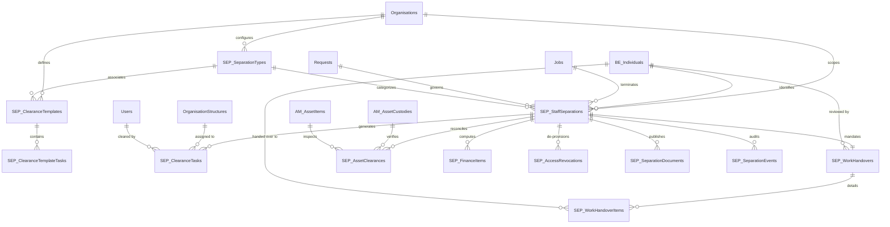

# Staff Separation, Offboarding and Clearance Management — Database Specification & Schema Design

## 1. Overview & Architectural Context

The Staff Separation, Offboarding and Clearance Management module provides enterprise-grade, auditable workflows for managing employee departures across diverse separation categories (resignation, retirement, contract expiry, employer-initiated termination, mutual release, and medical invalidation).

### Architectural Directives
- **Zero Duplication**: Leverages existing core entities: `BE_Individuals`, `Jobs`, `JobPositions`, `Organisations`, `OrganisationStructures`, `Users`, `UserOrganisationRoles`, `dbo.Requests`, `AM_AssetCustodies`, `AM_AssetItems`, `AM_AssetReturns`, `AM_AssetConditions`, and `OperationLogs`.
- **Naming Standard**: Physical tables adopt the standard feature prefix `SEP_` followed by descriptive PascalCase plural names.
- **Configurable Departmental & Domain Clearance**: Clearance workflows are configurable per organisation and separation type through templates rather than hardcoded department structures.
- **Data Protection & Immutability**: Historical identities, employment records, approval histories, and audit trails are preserved without deletion.
- **Independent Tracking**: Handover, asset custody, finance settlement, IT accounts, eFaas organisation links, and physical security clearance are tracked independently with dedicated states, waivers, and outstanding balance tracking.
- **Optimistic Concurrency**: Optimistic concurrency tokens (`rowversion`) protect concurrent updates across clearance tasks and separation headers.

---

## 2. Table Reuse & Integration Mapping

| Existing Entity / Table | Physical Name | Separation Module Interaction & Purpose |
| :--- | :--- | :--- |
| `Individual` | `dbo.BE_Individuals` | Primary employee identity reference (`IndividualId`), supervisor identity, and handover recipient identity. |
| `Job` | `dbo.Jobs` | Employment contract record being terminated. Upon final separation activation, `TerminatedDate` and `JobStateID` are updated idempotently. |
| `JobPosition` | `dbo.JobPositions` | Position tenure records for the job. Active positions have `ToDate` set to `EffectiveSeparationDate`. |
| `Organisation` | `dbo.Organisations` | Multi-tenant employer entity scoping separation policies, templates, and records. |
| `OrganisationStructure` | `dbo.OrganisationStructures` | Department/division of the separating employee and assigning clearance task responsibilities. |
| `Request` | `dbo.Requests` | Unified workflow request header linking to standard HRM inbox, state transitions, and audit trail. |
| `User` | `dbo.Users` | HRM login account for the employee and actors. Portal access is deprovisioned on effective separation date without deleting user record. |
| `UserOrganisationRole` | `dbo.UserOrganisationRoles` | Employee's organizational access roles deprovisioned upon termination execution. |
| `AM_AssetCustody` | `dbo.AM_AssetCustodies` | Active asset items currently in custody of the separating employee. |
| `AM_AssetItem` | `dbo.AM_AssetItems` | Physical serialized asset records inspected and cleared. |
| `AM_AssetReturn` / Items | `dbo.AM_AssetReturns`, `dbo.AM_AssetReturnItems` | Official asset return inspection records generated upon equipment handover. |
| `AM_AssetCondition` | `dbo.AM_AssetConditions` | Standard asset condition grading upon return. |
| `OperationLog` | `dbo.OperationLogs` | System-wide transaction and mutation tracking. |

---

## 3. Entity-Relationship (ER) Diagram



---

## 4. Complete Schema & Field Specification (Data Dictionary)

### 4.1. `dbo.SEP_SeparationTypes`
Defines configurable separation categories (e.g. Resignation, Retirement, Contract Expiry, Dismissal, Mutual Release).

| Column Name | SQL Type | Nullable | Constraints & Defaults | Business Purpose |
| :--- | :--- | :--- | :--- | :--- |
| `SeparationTypeId` | `int` | NO | PK, IDENTITY(1,1) | Unique surrogate key. |
| `OrganisationId` | `int` | YES | FK -> `Organisations.OrganisationBusinessEntityID` | Specific organisation scope, or NULL for system standard. |
| `Code` | `nvarchar(50)` | NO | Unique per Org | Machine code (e.g. `RESIGNATION`, `RETIREMENT`, `EXPIRY`). |
| `Name` | `nvarchar(150)` | NO |  | User-facing display title. |
| `Category` | `nvarchar(50)` | NO | Check constraint | Classification: `Voluntary`, `Involuntary`, `Retirement`, `Expiry`, `Mutual`. |
| `DefaultNoticeDays` | `int` | NO | DEFAULT 30 | Standard notice period in calendar days. |
| `RequiresClearance` | `bit` | NO | DEFAULT 1 | Whether full multi-domain clearance workflow is enforced. |
| `RequiresExitInterview`| `bit` | NO | DEFAULT 1 | Whether exit interview scheduling and notes are required. |
| `AllowsNoticeWaiver`| `bit` | NO | DEFAULT 1 | Whether notice shortfall/waiver requests can be filed. |
| `Description` | `nvarchar(500)` | YES |  | Contextual explanation and policy notes. |
| `IsActive` | `bit` | NO | DEFAULT 1 | Soft-deletion flag. |
| `SortOrder` | `int` | NO | DEFAULT 0 | Ordering index in dropdown lists. |
| `CreatedAtUtc` | `datetime2` | NO | DEFAULT SYSUTCDATETIME() | Audit creation timestamp. |
| `UpdatedAtUtc` | `datetime2` | NO | DEFAULT SYSUTCDATETIME() | Audit modification timestamp. |

---

### 4.2. `dbo.SEP_ClearanceTemplates`
Defines configurable clearance checklists per organisation, separation type, and job family/type.

| Column Name | SQL Type | Nullable | Constraints & Defaults | Business Purpose |
| :--- | :--- | :--- | :--- | :--- |
| `ClearanceTemplateId` | `int` | NO | PK, IDENTITY(1,1) | Unique surrogate key. |
| `OrganisationId` | `int` | NO | FK -> `Organisations.OrganisationBusinessEntityID` | Owning organisation tenant. |
| `SeparationTypeId` | `int` | YES | FK -> `SEP_SeparationTypes` | Optional separation type filter (NULL applies to all). |
| `JobTypeId` | `int` | YES | FK -> `JobTypes` | Optional job type filter (e.g. Technical Staff, Executives). |
| `TemplateName` | `nvarchar(150)`| NO |  | Descriptive template label. |
| `Description` | `nvarchar(500)`| YES |  | Policy purpose and scope notes. |
| `IsDefault` | `bit` | NO | DEFAULT 0 | Fallback template for organisation if no specific match. |
| `IsActive` | `bit` | NO | DEFAULT 1 | Active state. |
| `CreatedAtUtc` | `datetime2` | NO | DEFAULT SYSUTCDATETIME() | Audit timestamp. |
| `UpdatedAtUtc` | `datetime2` | NO | DEFAULT SYSUTCDATETIME() | Audit timestamp. |

---

### 4.3. `dbo.SEP_ClearanceTemplateTasks`
Task templates defining mandatory checkpoints for each domain under a template.

| Column Name | SQL Type | Nullable | Constraints & Defaults | Business Purpose |
| :--- | :--- | :--- | :--- | :--- |
| `ClearanceTemplateTaskId` | `int` | NO | PK, IDENTITY(1,1) | Unique key. |
| `ClearanceTemplateId` | `int` | NO | FK -> `SEP_ClearanceTemplates` | Parent template. |
| `Domain` | `nvarchar(50)` | NO | Check constraint | `SupervisorHandover`, `AssetReturn`, `FinanceSettlement`, `ItRevocation`, `SecurityDoorAccess`, `DepartmentalClearance`. |
| `TaskName` | `nvarchar(200)`| NO |  | Clear operational requirement title. |
| `TaskDescription` | `nvarchar(500)`| YES |  | Step-by-step clearance instructions. |
| `AssignedOrganisationStructureId` | `int` | YES | FK -> `OrganisationStructures` | Assigned reviewing department. |
| `AssignedRoleId` | `int` | YES | FK -> `Roles` | Required reviewer role (e.g. IT Admin, Finance Officer). |
| `IsMandatory` | `bit` | NO | DEFAULT 1 | Whether separation execution is blocked if uncleared. |
| `SequenceOrder` | `int` | NO | DEFAULT 0 | Visual and evaluation sequence. |
| `CreatedAtUtc` | `datetime2` | NO | DEFAULT SYSUTCDATETIME() | Audit timestamp. |

---

### 4.4. `dbo.SEP_StaffSeparations`
Master separation record containing employee snapshots, notice timeline, acknowledgement, HR review, and execution outcome.

| Column Name | SQL Type | Nullable | Constraints & Defaults | Business Purpose |
| :--- | :--- | :--- | :--- | :--- |
| `StaffSeparationId` | `int` | NO | PK, IDENTITY(1,1) | Unique separation record key. |
| `RequestId` | `int` | YES | FK -> `Requests.RequestID` | Shared HRM workflow request header. |
| `IndividualId` | `int` | NO | FK -> `BE_Individuals.BusinessEntityID` | Separating employee person record. |
| `JobId` | `int` | NO | FK -> `Jobs.JobID` | Job record being terminated. |
| `OrganisationId` | `int` | NO | FK -> `Organisations.OrganisationBusinessEntityID` | Employing tenant organisation. |
| `OrganisationStructureId` | `int` | NO | FK -> `OrganisationStructures.OrganisationStructureID` | Department at time of separation. |
| `SeparationTypeId` | `int` | NO | FK -> `SEP_SeparationTypes` | Governing separation type policy. |
| `ReasonCategory` | `nvarchar(50)` | NO |  | Category snapshot (`Resignation`, `Retirement`, etc.). |
| `ReasonDetails` | `nvarchar(max)`| NO |  | Formal written justification / notice explanation. |
| `InitiationSource` | `nvarchar(50)` | NO | DEFAULT 'EmployeeSelf' | `EmployeeSelf`, `Supervisor`, `HRAdmin`, `SystemRule`. |
| `RequestedNoticeDate` | `date` | NO |  | Date notice was formally tendered or issued. |
| `ContractualNoticeDays`| `int` | NO |  | Applicable contractual notice duration. |
| `NoticeWaiverRequested`| `bit` | NO | DEFAULT 0 | Employee requested shortening of notice. |
| `NoticeWaiverApproved` | `bit` | NO | DEFAULT 0 | HR/Management agreed to waive remaining days. |
| `NoticeWaiverDays` | `int` | NO | DEFAULT 0 | Approved waived calendar days. |
| `NoticeShortfallDays` | `int` | NO | DEFAULT 0 | Unserved days liable for salary deduction. |
| `NoticeShortfallPenaltyAmount` | `decimal(18,2)` | NO | DEFAULT 0 | Monetary penalty added to finance clearance. |
| `LastWorkingDate` | `date` | NO |  | Final physical presence / working date. |
| `EffectiveSeparationDate` | `date` | NO |  | Legal employment termination date. |
| `Status` | `nvarchar(50)` | NO | DEFAULT 'Draft' | Lifecycle status (`Draft`, `Submitted`, `UnderReview`, `HandoverInProgress`, `ClearanceInProgress`, `FinalReviewPending`, `Approved`, `Terminated`, `Cancelled`, `Rejected`). |
| `EmployeeAcknowledgementStatus` | `nvarchar(50)` | NO | DEFAULT 'Pending' | `Pending`, `Acknowledged`, `Disputed`. |
| `EmployeeAcknowledgedAtUtc` | `datetime2` | YES |  | Timestamp of employee sign-off on exit instructions. |
| `EmployeeExitComments` | `nvarchar(max)` | YES |  | Employee feedback / exit clarification notes. |
| `ExitInterviewCompleted` | `bit` | NO | DEFAULT 0 | Whether exit interview took place. |
| `ExitInterviewDate` | `date` | YES |  | Date of interview. |
| `ExitInterviewNotes` | `nvarchar(max)` | YES |  | Confidential HR exit feedback summary. |
| `FullNameSnapshot` | `nvarchar(250)` | NO |  | Immutable staff name snapshot. |
| `EmployeeNumberSnapshot` | `nvarchar(50)` | NO |  | Permanent staff code snapshot. |
| `ProtectedIdCardSnapshot`| `nvarchar(100)` | YES |  | National identity snapshot. |
| `PositionTitleSnapshot`| `nvarchar(200)` | NO |  | Designation snapshot. |
| `OrganisationNameSnapshot`| `nvarchar(250)`| NO |  | Employer snapshot. |
| `DepartmentNameSnapshot`| `nvarchar(250)`| NO |  | Department snapshot. |
| `DateJoinedSnapshot` | `date` | NO |  | Employment start date snapshot. |
| `BasicSalarySnapshot` | `decimal(18,2)` | YES |  | Last drawn basic salary snapshot. |
| `SupervisorIndividualId` | `int` | YES | FK -> `BE_Individuals` | Immediate reporting manager. |
| `SupervisorNameSnapshot`| `nvarchar(250)`| YES |  | Manager name snapshot. |
| `OfficialEmailSnapshot` | `nvarchar(128)` | YES |  | De-provisioned corporate email. |
| `PersonalContactNumber`| `nvarchar(50)` | YES |  | Post-employment contact telephone. |
| `PersonalEmail` | `nvarchar(128)` | YES |  | Post-employment personal email. |
| `ForwardingAddress` | `nvarchar(500)` | YES |  | Forwarding postal address for settlement delivery. |
| `HrAdminReviewerUserId`| `int` | YES | FK -> `Users` | Final reviewing HR officer. |
| `HrAdminReviewedAtUtc` | `datetime2` | YES |  | Timestamp of final HR audit sign-off. |
| `HrReviewRemarks` | `nvarchar(max)` | YES |  | HR final audit commentary. |
| `TerminationExecutedAtUtc` | `datetime2` | YES |  | Timestamp when job state, access, and accounts were revoked. |
| `ExecutedByUserId` | `int` | YES | FK -> `Users` | Admin user who triggered execution. |
| `HasUnresolvedObligations` | `bit` | NO | DEFAULT 0 | Post-separation flag for pending recoveries. |
| `UnresolvedObligationsSummary` | `nvarchar(max)` | YES |  | Description of unrecovered assets or loan debts. |
| `CreatedByUserId` | `int` | NO | FK -> `Users` | Submitting user ID. |
| `CreatedAtUtc` | `datetime2` | NO | DEFAULT SYSUTCDATETIME() | Creation audit timestamp. |
| `UpdatedAtUtc` | `datetime2` | NO | DEFAULT SYSUTCDATETIME() | Modification audit timestamp. |
| `RowVersion` | `rowversion` | NO |  | Concurrency token. |

---

### 4.5. `dbo.SEP_ClearanceTasks`
Generated clearance instances per domain. Tracks individual approvals, waivers, and monetary blocks.

| Column Name | SQL Type | Nullable | Constraints & Defaults | Business Purpose |
| :--- | :--- | :--- | :--- | :--- |
| `ClearanceTaskId` | `int` | NO | PK, IDENTITY(1,1) | Unique task key. |
| `StaffSeparationId` | `int` | NO | FK -> `SEP_StaffSeparations` | Parent separation record. |
| `Domain` | `nvarchar(50)` | NO |  | Task domain classification. |
| `TaskName` | `nvarchar(200)`| NO |  | Operational task title. |
| `TaskDescription` | `nvarchar(1000)`| YES |  | Detailed criteria for clearance. |
| `AssignedOrganisationStructureId` | `int` | YES | FK -> `OrganisationStructures` | Assigned department. |
| `AssignedToUserId` | `int` | YES | FK -> `Users` | Specific assigned officer. |
| `AssignedToRoleId` | `int` | YES | FK -> `Roles` | Required role authority. |
| `Status` | `nvarchar(50)` | NO | DEFAULT 'Pending' | `Pending`, `InProgress`, `Cleared`, `Waived`, `Blocked`. |
| `IsMandatory` | `bit` | NO | DEFAULT 1 | If 1, blocks overall clearance if unaddressed. |
| `SequenceOrder` | `int` | NO | DEFAULT 0 | Display sequence. |
| `ClearedByUserId` | `int` | YES | FK -> `Users` | Officer who signed off. |
| `ClearedAtUtc` | `datetime2` | YES |  | Sign-off timestamp. |
| `Remarks` | `nvarchar(max)`| YES |  | Review notes and audit observations. |
| `WaiverReason` | `nvarchar(max)`| YES |  | Justification if marked `Waived`. |
| `OutstandingObligation`| `bit` | NO | DEFAULT 0 | Unresolved discrepancy flagged. |
| `OutstandingObligationAmount` | `decimal(18,2)` | YES |  | Dollar value of pending liability. |
| `OutstandingObligationDetails` | `nvarchar(max)` | YES |  | Particulars of liability. |
| `RowVersion` | `rowversion` | NO |  | Concurrency token. |

---

### 4.6. `dbo.SEP_WorkHandovers` & `dbo.SEP_WorkHandoverItems`
Tracks operational handover of project assignments, active workflow requests, duties, and files with supervisor and HOD verification.

#### `dbo.SEP_WorkHandovers`
| Column Name | SQL Type | Nullable | Constraints & Defaults | Business Purpose |
| :--- | :--- | :--- | :--- | :--- |
| `WorkHandoverId` | `int` | NO | PK, IDENTITY(1,1) | Unique handover header key. |
| `StaffSeparationId` | `int` | NO | FK -> `SEP_StaffSeparations` | Linked separation. |
| `SupervisorIndividualId` | `int` | NO | FK -> `BE_Individuals` | Immediate reporting manager. |
| `HodIndividualId` | `int` | YES | FK -> `BE_Individuals` | Head of Department / Division. |
| `SupervisorStatus` | `nvarchar(50)` | NO | DEFAULT 'Pending' | `Pending`, `InReview`, `Approved`, `ChangesRequested`. |
| `SupervisorReviewedAtUtc` | `datetime2` | YES |  | Manager review timestamp. |
| `SupervisorComments` | `nvarchar(max)` | YES |  | Manager remarks. |
| `HodStatus` | `nvarchar(50)` | NO | DEFAULT 'Pending' | `Pending`, `InReview`, `Approved`, `ChangesRequested`. |
| `HodReviewedAtUtc` | `datetime2` | YES |  | HOD review timestamp. |
| `HodComments` | `nvarchar(max)` | YES |  | HOD executive remarks. |
| `AllItemsCompleted` | `bit` | NO | DEFAULT 0 | Aggregated check that all line items are resolved. |
| `CreatedAtUtc` | `datetime2` | NO | DEFAULT SYSUTCDATETIME() | Audit timestamp. |
| `UpdatedAtUtc` | `datetime2` | NO | DEFAULT SYSUTCDATETIME() | Audit timestamp. |

#### `dbo.SEP_WorkHandoverItems`
| Column Name | SQL Type | Nullable | Constraints & Defaults | Business Purpose |
| :--- | :--- | :--- | :--- | :--- |
| `WorkHandoverItemId` | `int` | NO | PK, IDENTITY(1,1) | Line item key. |
| `WorkHandoverId` | `int` | NO | FK -> `SEP_WorkHandovers` | Parent handover header. |
| `StaffSeparationId` | `int` | NO | FK -> `SEP_StaffSeparations` | Denormalized separation key for fast querying. |
| `ItemType` | `nvarchar(50)` | NO |  | `ProjectAssignment`, `OperationalDuty`, `FileOrDocument`, `OpenWorkflowTask`, `SystemAdminRole`, `Other`. |
| `ItemTitle` | `nvarchar(250)`| NO |  | Assignment / duty title. |
| `Details` | `nvarchar(max)`| YES |  | Handover instructions, file URLs, and credentials status. |
| `RecipientIndividualId` | `int` | NO | FK -> `BE_Individuals` | Colleague taking over responsibility. |
| `TargetCompletionDate` | `date` | NO |  | Expected handover milestone date. |
| `Status` | `nvarchar(50)` | NO | DEFAULT 'Pending' | `Pending`, `HandedOver`, `Verified`, `Waived`. |
| `VerifiedByIndividualId`| `int` | YES | FK -> `BE_Individuals` | Verifier (usually supervisor or recipient). |
| `VerifiedAtUtc` | `datetime2` | YES |  | Verification timestamp. |
| `HandoverNotes` | `nvarchar(max)`| YES |  | Audit completion notes. |

---

### 4.7. `dbo.SEP_AssetClearances`
Directly integrates with the existing Asset Custody subsystem (`AM_AssetCustodies`, `AM_AssetItems`, `AM_AssetReturns`).

| Column Name | SQL Type | Nullable | Constraints & Defaults | Business Purpose |
| :--- | :--- | :--- | :--- | :--- |
| `SeparationAssetClearanceId` | `int` | NO | PK, IDENTITY(1,1) | Unique key. |
| `StaffSeparationId` | `int` | NO | FK -> `SEP_StaffSeparations` | Parent separation record. |
| `AssetCustodyId` | `int` | YES | FK -> `AM_AssetCustodies` | Active custody record. |
| `AssetItemId` | `int` | NO | FK -> `AM_AssetItems` | Physical serialized asset. |
| `AssetReturnId` | `int` | YES | FK -> `AM_AssetReturns` | Linked asset return ticket. |
| `AssetReturnItemId` | `int` | YES | FK -> `AM_AssetReturnItems` | Inspected return line item. |
| `ConditionOnReturnId` | `int` | YES | FK -> `AM_AssetConditions` | Physical condition grading. |
| `DisposalAction` | `nvarchar(50)` | NO | DEFAULT 'PendingReturn'| `PendingReturn`, `ReturnedInGoodOrder`, `ReturnedDamaged`, `ReportedLost`, `KeptBuyout`, `Waived`. |
| `AssessedDamageCost` | `decimal(18,2)` | YES |  | Assessed repair or replacement bill. |
| `DeductionFromFinalSettlement` | `bit` | NO | DEFAULT 0 | Automatic debit to separation finance reconciliation. |
| `Status` | `nvarchar(50)` | NO | DEFAULT 'PendingReturn'| `PendingReturn`, `Inspected`, `Cleared`, `Disputed`. |
| `VerifiedByUserId` | `int` | YES | FK -> `Users` | Asset custodian officer. |
| `VerifiedAtUtc` | `datetime2` | YES |  | Inspection timestamp. |
| `Remarks` | `nvarchar(max)`| YES |  | Serial number check, missing accessory notes. |

---

### 4.8. `dbo.SEP_FinanceItems`
Reconciles final payout, arrears, unutilized leave encashment, loans, advances, damage recoveries, and shortfall penalties.

| Column Name | SQL Type | Nullable | Constraints & Defaults | Business Purpose |
| :--- | :--- | :--- | :--- | :--- |
| `SeparationFinanceItemId`| `int` | NO | PK, IDENTITY(1,1) | Unique finance item key. |
| `StaffSeparationId` | `int` | NO | FK -> `SEP_StaffSeparations` | Linked separation. |
| `Category` | `nvarchar(50)` | NO |  | `SalaryArrears`, `UnusedLeaveEncashment`, `Gratuity`, `Severance`, `LoanDeduction`, `AdvanceRecovery`, `AssetDamageDeduction`, `NoticePenaltyDeduction`, `OtherAdjustment`. |
| `Description` | `nvarchar(250)`| NO |  | Detailed breakdown line description. |
| `IsCredit` | `bit` | NO |  | 1 = Credit (Payable to employee), 0 = Debit (Deduction from employee). |
| `Amount` | `decimal(18,2)` | NO | CHECK (Amount >= 0) | Monetary figure. |
| `IsCleared` | `bit` | NO | DEFAULT 0 | Confirmed and settled in payroll/finance. |
| `PayrollBatchReference` | `nvarchar(100)`| YES |  | Associated payroll batch or voucher code. |
| `Remarks` | `nvarchar(max)`| YES |  | Calculation basis and balance notes. |
| `VerifiedByUserId` | `int` | YES | FK -> `Users` | Finance clearance officer. |
| `VerifiedAtUtc` | `datetime2` | YES |  | Payout sign-off timestamp. |

---

### 4.9. `dbo.SEP_AccessRevocations`
Controls revocation of digital accounts, application roles, eFaas organization mappings, building smartcards, and physical office keys.

| Column Name | SQL Type | Nullable | Constraints & Defaults | Business Purpose |
| :--- | :--- | :--- | :--- | :--- |
| `SeparationAccessRevocationId`| `int` | NO | PK, IDENTITY(1,1) | Unique key. |
| `StaffSeparationId` | `int` | NO | FK -> `SEP_StaffSeparations` | Linked separation. |
| `SystemType` | `nvarchar(50)` | NO |  | `HrmPortal`, `AdminPortal`, `ActiveDirectory`, `EmailExchange`, `EFaasOrgLink`, `DoorAccessCard`, `PhysicalKey`, `VpnAccess`, `ThirdPartyApp`. |
| `SystemName` | `nvarchar(150)`| NO |  | Human-readable target (e.g. "Primary Office Keycard", "Corporate O365"). |
| `AccountIdentifier` | `nvarchar(150)`| NO |  | Account login, UPN, smartcard serial, or key number. |
| `DoorBuildingName` | `nvarchar(150)`| YES |  | Building / facility name for door access items. |
| `DoorCardNumber` | `nvarchar(100)`| YES |  | Card or fob serial number. |
| `RevocationAction` | `nvarchar(50)` | NO |  | `RevokeAccess`, `DisableAccount`, `DeleteAccount`, `ReassignMailbox`, `PhysicalCardCollected`. |
| `ScheduledRevocationDate`| `date` | NO |  | Target revocation date (normally `LastWorkingDate`). |
| `Status` | `nvarchar(50)` | NO | DEFAULT 'Pending' | `Pending`, `Scheduled`, `Revoked`, `CardCollected`, `Failed`, `Waived`. |
| `RevokedAtUtc` | `datetime2` | YES |  | Deprovisioning execution timestamp. |
| `RevokedByUserId` | `int` | YES | FK -> `Users` | Security or IT officer performing revocation. |
| `ExecutionNotes` | `nvarchar(max)`| YES |  | Deprovisioning confirmation logs and ticket links. |

---

### 4.10. `dbo.SEP_SeparationDocuments`
Stores official generated PDF documents (Clearance Certificate, Resignation Acceptance, Service Certificate, Final Settlement Statement).

| Column Name | SQL Type | Nullable | Constraints & Defaults | Business Purpose |
| :--- | :--- | :--- | :--- | :--- |
| `SeparationDocumentId`| `bigint` | NO | PK, IDENTITY(1,1) | Unique document ID. |
| `StaffSeparationId` | `int` | NO | FK -> `SEP_StaffSeparations` | Parent separation record. |
| `DocumentNumber` | `nvarchar(100)`| NO |  | Official administrative serial / letter number. |
| `DocumentVariant` | `nvarchar(50)` | NO |  | `ExitClearanceCertificate`, `ResignationAcceptanceLetter`, `ServiceCertificate`, `HandoverCertificate`, `FinalSettlementStatement`. |
| `Title` | `nvarchar(250)`| NO |  | Formal document header. |
| `PdfBytes` | `varbinary(max)`| YES |  | Complete printable PDF binary data. |
| `ContentType` | `nvarchar(100)`| NO | DEFAULT 'application/pdf' | MIME content type. |
| `Sha256Hash` | `nvarchar(64)` | NO |  | Cryptographic integrity hash. |
| `GeneratedByUserId` | `int` | NO | FK -> `Users` | User who generated document. |
| `GeneratedAtUtc` | `datetime2` | NO | DEFAULT SYSUTCDATETIME() | Issuance timestamp. |

---

### 4.11. `dbo.SEP_SeparationEvents`
Append-only immutable audit trail recording every state change, review, clearance, waiver, and deprovisioning step.

| Column Name | SQL Type | Nullable | Constraints & Defaults | Business Purpose |
| :--- | :--- | :--- | :--- | :--- |
| `SeparationEventId` | `bigint` | NO | PK, IDENTITY(1,1) | Unique audit event ID. |
| `StaffSeparationId` | `int` | NO | FK -> `SEP_StaffSeparations` | Parent separation record. |
| `EventType` | `nvarchar(50)` | NO |  | Event categorization code. |
| `EventTitle` | `nvarchar(200)`| NO |  | Brief descriptive summary. |
| `DetailsJson` | `nvarchar(max)`| YES |  | Contextual payload and before/after values. |
| `ActorUserId` | `int` | NO | FK -> `Users` | User responsible for change. |
| `ActorName` | `nvarchar(150)`| NO |  | User display name snapshot. |
| `OccurredAtUtc` | `datetime2` | NO | DEFAULT SYSUTCDATETIME() | Wall-clock audit timestamp. |

---

## 5. SQL Server DDL Script

```sql
-- ============================================================================
-- Feature: Enterprise Staff Separation, Offboarding and Clearance Management
-- Prefix: SEP_
-- ============================================================================

IF NOT EXISTS (SELECT * FROM sys.tables WHERE name = 'SEP_SeparationTypes')
BEGIN
    CREATE TABLE dbo.SEP_SeparationTypes (
        SeparationTypeId INT IDENTITY(1,1) NOT NULL,
        OrganisationId INT NULL,
        Code NVARCHAR(50) NOT NULL,
        Name NVARCHAR(150) NOT NULL,
        Category NVARCHAR(50) NOT NULL,
        DefaultNoticeDays INT NOT NULL CONSTRAINT DF_SEP_SeparationTypes_DefaultNoticeDays DEFAULT (30),
        RequiresClearance BIT NOT NULL CONSTRAINT DF_SEP_SeparationTypes_RequiresClearance DEFAULT (1),
        RequiresExitInterview BIT NOT NULL CONSTRAINT DF_SEP_SeparationTypes_RequiresExitInterview DEFAULT (1),
        AllowsNoticeWaiver BIT NOT NULL CONSTRAINT DF_SEP_SeparationTypes_AllowsNoticeWaiver DEFAULT (1),
        Description NVARCHAR(500) NULL,
        IsActive BIT NOT NULL CONSTRAINT DF_SEP_SeparationTypes_IsActive DEFAULT (1),
        SortOrder INT NOT NULL CONSTRAINT DF_SEP_SeparationTypes_SortOrder DEFAULT (0),
        CreatedAtUtc DATETIME2 NOT NULL CONSTRAINT DF_SEP_SeparationTypes_CreatedAtUtc DEFAULT (SYSUTCDATETIME()),
        UpdatedAtUtc DATETIME2 NOT NULL CONSTRAINT DF_SEP_SeparationTypes_UpdatedAtUtc DEFAULT (SYSUTCDATETIME()),
        CONSTRAINT PK_SEP_SeparationTypes PRIMARY KEY CLUSTERED (SeparationTypeId),
        CONSTRAINT FK_SEP_SeparationTypes_Organisations FOREIGN KEY (OrganisationId) REFERENCES dbo.Organisations (OrganisationBusinessEntityID) ON DELETE SET NULL
    );

    CREATE UNIQUE NONCLUSTERED INDEX UX_SEP_SeparationTypes_Code_Org ON dbo.SEP_SeparationTypes (Code, OrganisationId);
END;

IF NOT EXISTS (SELECT * FROM sys.tables WHERE name = 'SEP_ClearanceTemplates')
BEGIN
    CREATE TABLE dbo.SEP_ClearanceTemplates (
        ClearanceTemplateId INT IDENTITY(1,1) NOT NULL,
        OrganisationId INT NOT NULL,
        SeparationTypeId INT NULL,
        JobTypeId INT NULL,
        TemplateName NVARCHAR(150) NOT NULL,
        Description NVARCHAR(500) NULL,
        IsDefault BIT NOT NULL CONSTRAINT DF_SEP_ClearanceTemplates_IsDefault DEFAULT (0),
        IsActive BIT NOT NULL CONSTRAINT DF_SEP_ClearanceTemplates_IsActive DEFAULT (1),
        CreatedAtUtc DATETIME2 NOT NULL CONSTRAINT DF_SEP_ClearanceTemplates_CreatedAtUtc DEFAULT (SYSUTCDATETIME()),
        UpdatedAtUtc DATETIME2 NOT NULL CONSTRAINT DF_SEP_ClearanceTemplates_UpdatedAtUtc DEFAULT (SYSUTCDATETIME()),
        CONSTRAINT PK_SEP_ClearanceTemplates PRIMARY KEY CLUSTERED (ClearanceTemplateId),
        CONSTRAINT FK_SEP_ClearanceTemplates_Organisations FOREIGN KEY (OrganisationId) REFERENCES dbo.Organisations (OrganisationBusinessEntityID),
        CONSTRAINT FK_SEP_ClearanceTemplates_SeparationTypes FOREIGN KEY (SeparationTypeId) REFERENCES dbo.SEP_SeparationTypes (SeparationTypeId) ON DELETE SET NULL,
        CONSTRAINT FK_SEP_ClearanceTemplates_JobTypes FOREIGN KEY (JobTypeId) REFERENCES dbo.JobTypes (JobTypeID) ON DELETE SET NULL
    );

    CREATE INDEX IX_SEP_ClearanceTemplates_Org_Type ON dbo.SEP_ClearanceTemplates (OrganisationId, SeparationTypeId, JobTypeId);
END;

IF NOT EXISTS (SELECT * FROM sys.tables WHERE name = 'SEP_ClearanceTemplateTasks')
BEGIN
    CREATE TABLE dbo.SEP_ClearanceTemplateTasks (
        ClearanceTemplateTaskId INT IDENTITY(1,1) NOT NULL,
        ClearanceTemplateId INT NOT NULL,
        Domain NVARCHAR(50) NOT NULL,
        TaskName NVARCHAR(200) NOT NULL,
        TaskDescription NVARCHAR(500) NULL,
        AssignedOrganisationStructureId INT NULL,
        AssignedRoleId INT NULL,
        IsMandatory BIT NOT NULL CONSTRAINT DF_SEP_ClearanceTemplateTasks_IsMandatory DEFAULT (1),
        SequenceOrder INT NOT NULL CONSTRAINT DF_SEP_ClearanceTemplateTasks_SequenceOrder DEFAULT (0),
        CreatedAtUtc DATETIME2 NOT NULL CONSTRAINT DF_SEP_ClearanceTemplateTasks_CreatedAtUtc DEFAULT (SYSUTCDATETIME()),
        CONSTRAINT PK_SEP_ClearanceTemplateTasks PRIMARY KEY CLUSTERED (ClearanceTemplateTaskId),
        CONSTRAINT FK_SEP_ClearanceTemplateTasks_Templates FOREIGN KEY (ClearanceTemplateId) REFERENCES dbo.SEP_ClearanceTemplates (ClearanceTemplateId) ON DELETE CASCADE,
        CONSTRAINT FK_SEP_ClearanceTemplateTasks_OrgStructure FOREIGN KEY (AssignedOrganisationStructureId) REFERENCES dbo.OrganisationStructures (OrganisationStructureID) ON DELETE SET NULL,
        CONSTRAINT FK_SEP_ClearanceTemplateTasks_Roles FOREIGN KEY (AssignedRoleId) REFERENCES dbo.Roles (RoleID) ON DELETE SET NULL
    );

    CREATE INDEX IX_SEP_ClearanceTemplateTasks_TemplateId ON dbo.SEP_ClearanceTemplateTasks (ClearanceTemplateId, SequenceOrder);
END;

IF NOT EXISTS (SELECT * FROM sys.tables WHERE name = 'SEP_StaffSeparations')
BEGIN
    CREATE TABLE dbo.SEP_StaffSeparations (
        StaffSeparationId INT IDENTITY(1,1) NOT NULL,
        RequestId INT NULL,
        IndividualId INT NOT NULL,
        JobId INT NOT NULL,
        OrganisationId INT NOT NULL,
        OrganisationStructureId INT NOT NULL,
        SeparationTypeId INT NOT NULL,
        ReasonCategory NVARCHAR(50) NOT NULL,
        ReasonDetails NVARCHAR(MAX) NOT NULL,
        InitiationSource NVARCHAR(50) NOT NULL CONSTRAINT DF_SEP_StaffSeparations_InitiationSource DEFAULT ('EmployeeSelf'),
        RequestedNoticeDate DATE NOT NULL,
        ContractualNoticeDays INT NOT NULL,
        NoticeWaiverRequested BIT NOT NULL CONSTRAINT DF_SEP_StaffSeparations_NoticeWaiverRequested DEFAULT (0),
        NoticeWaiverApproved BIT NOT NULL CONSTRAINT DF_SEP_StaffSeparations_NoticeWaiverApproved DEFAULT (0),
        NoticeWaiverDays INT NOT NULL CONSTRAINT DF_SEP_StaffSeparations_NoticeWaiverDays DEFAULT (0),
        NoticeShortfallDays INT NOT NULL CONSTRAINT DF_SEP_StaffSeparations_NoticeShortfallDays DEFAULT (0),
        NoticeShortfallPenaltyAmount DECIMAL(18,2) NOT NULL CONSTRAINT DF_SEP_StaffSeparations_NoticeShortfallPenaltyAmount DEFAULT (0),
        LastWorkingDate DATE NOT NULL,
        EffectiveSeparationDate DATE NOT NULL,
        Status NVARCHAR(50) NOT NULL CONSTRAINT DF_SEP_StaffSeparations_Status DEFAULT ('Draft'),
        EmployeeAcknowledgementStatus NVARCHAR(50) NOT NULL CONSTRAINT DF_SEP_StaffSeparations_EmployeeAcknowledgementStatus DEFAULT ('Pending'),
        EmployeeAcknowledgedAtUtc DATETIME2 NULL,
        EmployeeExitComments NVARCHAR(MAX) NULL,
        ExitInterviewCompleted BIT NOT NULL CONSTRAINT DF_SEP_StaffSeparations_ExitInterviewCompleted DEFAULT (0),
        ExitInterviewDate DATE NULL,
        ExitInterviewNotes NVARCHAR(MAX) NULL,
        FullNameSnapshot NVARCHAR(250) NOT NULL,
        EmployeeNumberSnapshot NVARCHAR(50) NOT NULL,
        ProtectedIdCardSnapshot NVARCHAR(100) NULL,
        PositionTitleSnapshot NVARCHAR(200) NOT NULL,
        OrganisationNameSnapshot NVARCHAR(250) NOT NULL,
        DepartmentNameSnapshot NVARCHAR(250) NOT NULL,
        DateJoinedSnapshot DATE NOT NULL,
        BasicSalarySnapshot DECIMAL(18,2) NULL,
        SupervisorIndividualId INT NULL,
        SupervisorNameSnapshot NVARCHAR(250) NULL,
        OfficialEmailSnapshot NVARCHAR(128) NULL,
        PersonalContactNumber NVARCHAR(50) NULL,
        PersonalEmail NVARCHAR(128) NULL,
        ForwardingAddress NVARCHAR(500) NULL,
        HrAdminReviewerUserId INT NULL,
        HrAdminReviewedAtUtc DATETIME2 NULL,
        HrReviewRemarks NVARCHAR(MAX) NULL,
        TerminationExecutedAtUtc DATETIME2 NULL,
        ExecutedByUserId INT NULL,
        HasUnresolvedObligations BIT NOT NULL CONSTRAINT DF_SEP_StaffSeparations_HasUnresolvedObligations DEFAULT (0),
        UnresolvedObligationsSummary NVARCHAR(MAX) NULL,
        CreatedByUserId INT NOT NULL,
        CreatedAtUtc DATETIME2 NOT NULL CONSTRAINT DF_SEP_StaffSeparations_CreatedAtUtc DEFAULT (SYSUTCDATETIME()),
        UpdatedAtUtc DATETIME2 NOT NULL CONSTRAINT DF_SEP_StaffSeparations_UpdatedAtUtc DEFAULT (SYSUTCDATETIME()),
        RowVersion ROWVERSION NOT NULL,
        CONSTRAINT PK_SEP_StaffSeparations PRIMARY KEY CLUSTERED (StaffSeparationId),
        CONSTRAINT FK_SEP_StaffSeparations_Requests FOREIGN KEY (RequestId) REFERENCES dbo.Requests (RequestID) ON DELETE SET NULL,
        CONSTRAINT FK_SEP_StaffSeparations_Individuals FOREIGN KEY (IndividualId) REFERENCES dbo.BE_Individuals (BusinessEntityID),
        CONSTRAINT FK_SEP_StaffSeparations_Jobs FOREIGN KEY (JobId) REFERENCES dbo.Jobs (JobID),
        CONSTRAINT FK_SEP_StaffSeparations_Organisations FOREIGN KEY (OrganisationId) REFERENCES dbo.Organisations (OrganisationBusinessEntityID),
        CONSTRAINT FK_SEP_StaffSeparations_OrgStructures FOREIGN KEY (OrganisationStructureId) REFERENCES dbo.OrganisationStructures (OrganisationStructureID),
        CONSTRAINT FK_SEP_StaffSeparations_Types FOREIGN KEY (SeparationTypeId) REFERENCES dbo.SEP_SeparationTypes (SeparationTypeId),
        CONSTRAINT FK_SEP_StaffSeparations_Supervisors FOREIGN KEY (SupervisorIndividualId) REFERENCES dbo.BE_Individuals (BusinessEntityID),
        CONSTRAINT FK_SEP_StaffSeparations_HrReviewer FOREIGN KEY (HrAdminReviewerUserId) REFERENCES dbo.Users (UserID),
        CONSTRAINT FK_SEP_StaffSeparations_Executor FOREIGN KEY (ExecutedByUserId) REFERENCES dbo.Users (UserID),
        CONSTRAINT FK_SEP_StaffSeparations_Creator FOREIGN KEY (CreatedByUserId) REFERENCES dbo.Users (UserID)
    );

    CREATE INDEX IX_SEP_StaffSeparations_Individual_Job ON dbo.SEP_StaffSeparations (IndividualId, JobId, Status);
    CREATE INDEX IX_SEP_StaffSeparations_Organisation_Status ON dbo.SEP_StaffSeparations (OrganisationId, Status, EffectiveSeparationDate);
END;

IF NOT EXISTS (SELECT * FROM sys.tables WHERE name = 'SEP_ClearanceTasks')
BEGIN
    CREATE TABLE dbo.SEP_ClearanceTasks (
        ClearanceTaskId INT IDENTITY(1,1) NOT NULL,
        StaffSeparationId INT NOT NULL,
        Domain NVARCHAR(50) NOT NULL,
        TaskName NVARCHAR(200) NOT NULL,
        TaskDescription NVARCHAR(1000) NULL,
        AssignedOrganisationStructureId INT NULL,
        AssignedToUserId INT NULL,
        AssignedToRoleId INT NULL,
        Status NVARCHAR(50) NOT NULL CONSTRAINT DF_SEP_ClearanceTasks_Status DEFAULT ('Pending'),
        IsMandatory BIT NOT NULL CONSTRAINT DF_SEP_ClearanceTasks_IsMandatory DEFAULT (1),
        SequenceOrder INT NOT NULL CONSTRAINT DF_SEP_ClearanceTasks_SequenceOrder DEFAULT (0),
        ClearedByUserId INT NULL,
        ClearedAtUtc DATETIME2 NULL,
        Remarks NVARCHAR(MAX) NULL,
        WaiverReason NVARCHAR(MAX) NULL,
        OutstandingObligation BIT NOT NULL CONSTRAINT DF_SEP_ClearanceTasks_OutstandingObligation DEFAULT (0),
        OutstandingObligationAmount DECIMAL(18,2) NULL,
        OutstandingObligationDetails NVARCHAR(MAX) NULL,
        RowVersion ROWVERSION NOT NULL,
        CONSTRAINT PK_SEP_ClearanceTasks PRIMARY KEY CLUSTERED (ClearanceTaskId),
        CONSTRAINT FK_SEP_ClearanceTasks_Separations FOREIGN KEY (StaffSeparationId) REFERENCES dbo.SEP_StaffSeparations (StaffSeparationId) ON DELETE CASCADE,
        CONSTRAINT FK_SEP_ClearanceTasks_Structures FOREIGN KEY (AssignedOrganisationStructureId) REFERENCES dbo.OrganisationStructures (OrganisationStructureID) ON DELETE SET NULL,
        CONSTRAINT FK_SEP_ClearanceTasks_AssignedUsers FOREIGN KEY (AssignedToUserId) REFERENCES dbo.Users (UserID) ON DELETE SET NULL,
        CONSTRAINT FK_SEP_ClearanceTasks_Roles FOREIGN KEY (AssignedToRoleId) REFERENCES dbo.Roles (RoleID) ON DELETE SET NULL,
        CONSTRAINT FK_SEP_ClearanceTasks_ClearedUsers FOREIGN KEY (ClearedByUserId) REFERENCES dbo.Users (UserID) ON DELETE SET NULL
    );

    CREATE INDEX IX_SEP_ClearanceTasks_Separation_Domain ON dbo.SEP_ClearanceTasks (StaffSeparationId, Domain, Status);
END;

IF NOT EXISTS (SELECT * FROM sys.tables WHERE name = 'SEP_WorkHandovers')
BEGIN
    CREATE TABLE dbo.SEP_WorkHandovers (
        WorkHandoverId INT IDENTITY(1,1) NOT NULL,
        StaffSeparationId INT NOT NULL,
        SupervisorIndividualId INT NOT NULL,
        HodIndividualId INT NULL,
        SupervisorStatus NVARCHAR(50) NOT NULL CONSTRAINT DF_SEP_WorkHandovers_SupervisorStatus DEFAULT ('Pending'),
        SupervisorReviewedAtUtc DATETIME2 NULL,
        SupervisorComments NVARCHAR(MAX) NULL,
        HodStatus NVARCHAR(50) NOT NULL CONSTRAINT DF_SEP_WorkHandovers_HodStatus DEFAULT ('Pending'),
        HodReviewedAtUtc DATETIME2 NULL,
        HodComments NVARCHAR(MAX) NULL,
        AllItemsCompleted BIT NOT NULL CONSTRAINT DF_SEP_WorkHandovers_AllItemsCompleted DEFAULT (0),
        CreatedAtUtc DATETIME2 NOT NULL CONSTRAINT DF_SEP_WorkHandovers_CreatedAtUtc DEFAULT (SYSUTCDATETIME()),
        UpdatedAtUtc DATETIME2 NOT NULL CONSTRAINT DF_SEP_WorkHandovers_UpdatedAtUtc DEFAULT (SYSUTCDATETIME()),
        CONSTRAINT PK_SEP_WorkHandovers PRIMARY KEY CLUSTERED (WorkHandoverId),
        CONSTRAINT FK_SEP_WorkHandovers_Separations FOREIGN KEY (StaffSeparationId) REFERENCES dbo.SEP_StaffSeparations (StaffSeparationId) ON DELETE CASCADE,
        CONSTRAINT FK_SEP_WorkHandovers_Supervisors FOREIGN KEY (SupervisorIndividualId) REFERENCES dbo.BE_Individuals (BusinessEntityID),
        CONSTRAINT FK_SEP_WorkHandovers_Hods FOREIGN KEY (HodIndividualId) REFERENCES dbo.BE_Individuals (BusinessEntityID)
    );

    CREATE UNIQUE NONCLUSTERED INDEX UX_SEP_WorkHandovers_SeparationId ON dbo.SEP_WorkHandovers (StaffSeparationId);
END;

IF NOT EXISTS (SELECT * FROM sys.tables WHERE name = 'SEP_WorkHandoverItems')
BEGIN
    CREATE TABLE dbo.SEP_WorkHandoverItems (
        WorkHandoverItemId INT IDENTITY(1,1) NOT NULL,
        WorkHandoverId INT NOT NULL,
        StaffSeparationId INT NOT NULL,
        ItemType NVARCHAR(50) NOT NULL,
        ItemTitle NVARCHAR(250) NOT NULL,
        Details NVARCHAR(MAX) NULL,
        RecipientIndividualId INT NOT NULL,
        TargetCompletionDate DATE NOT NULL,
        Status NVARCHAR(50) NOT NULL CONSTRAINT DF_SEP_WorkHandoverItems_Status DEFAULT ('Pending'),
        VerifiedByIndividualId INT NULL,
        VerifiedAtUtc DATETIME2 NULL,
        HandoverNotes NVARCHAR(MAX) NULL,
        CONSTRAINT PK_SEP_WorkHandoverItems PRIMARY KEY CLUSTERED (WorkHandoverItemId),
        CONSTRAINT FK_SEP_WorkHandoverItems_Handovers FOREIGN KEY (WorkHandoverId) REFERENCES dbo.SEP_WorkHandovers (WorkHandoverId) ON DELETE CASCADE,
        CONSTRAINT FK_SEP_WorkHandoverItems_Separations FOREIGN KEY (StaffSeparationId) REFERENCES dbo.SEP_StaffSeparations (StaffSeparationId),
        CONSTRAINT FK_SEP_WorkHandoverItems_Recipients FOREIGN KEY (RecipientIndividualId) REFERENCES dbo.BE_Individuals (BusinessEntityID),
        CONSTRAINT FK_SEP_WorkHandoverItems_Verifiers FOREIGN KEY (VerifiedByIndividualId) REFERENCES dbo.BE_Individuals (BusinessEntityID)
    );

    CREATE INDEX IX_SEP_WorkHandoverItems_HandoverId ON dbo.SEP_WorkHandoverItems (WorkHandoverId, Status);
END;

IF NOT EXISTS (SELECT * FROM sys.tables WHERE name = 'SEP_AssetClearances')
BEGIN
    CREATE TABLE dbo.SEP_AssetClearances (
        SeparationAssetClearanceId INT IDENTITY(1,1) NOT NULL,
        StaffSeparationId INT NOT NULL,
        AssetCustodyId INT NULL,
        AssetItemId INT NOT NULL,
        AssetReturnId INT NULL,
        AssetReturnItemId INT NULL,
        ConditionOnReturnId INT NULL,
        DisposalAction NVARCHAR(50) NOT NULL CONSTRAINT DF_SEP_AssetClearances_DisposalAction DEFAULT ('PendingReturn'),
        AssessedDamageCost DECIMAL(18,2) NULL,
        DeductionFromFinalSettlement BIT NOT NULL CONSTRAINT DF_SEP_AssetClearances_Deduction DEFAULT (0),
        Status NVARCHAR(50) NOT NULL CONSTRAINT DF_SEP_AssetClearances_Status DEFAULT ('PendingReturn'),
        VerifiedByUserId INT NULL,
        VerifiedAtUtc DATETIME2 NULL,
        Remarks NVARCHAR(MAX) NULL,
        CONSTRAINT PK_SEP_AssetClearances PRIMARY KEY CLUSTERED (SeparationAssetClearanceId),
        CONSTRAINT FK_SEP_AssetClearances_Separations FOREIGN KEY (StaffSeparationId) REFERENCES dbo.SEP_StaffSeparations (StaffSeparationId) ON DELETE CASCADE,
        CONSTRAINT FK_SEP_AssetClearances_Custodies FOREIGN KEY (AssetCustodyId) REFERENCES dbo.AM_AssetCustodies (AssetCustodyId) ON DELETE SET NULL,
        CONSTRAINT FK_SEP_AssetClearances_Items FOREIGN KEY (AssetItemId) REFERENCES dbo.AM_AssetItems (AssetItemId),
        CONSTRAINT FK_SEP_AssetClearances_Returns FOREIGN KEY (AssetReturnId) REFERENCES dbo.AM_AssetReturns (AssetReturnId) ON DELETE SET NULL,
        CONSTRAINT FK_SEP_AssetClearances_Conditions FOREIGN KEY (ConditionOnReturnId) REFERENCES dbo.AM_AssetConditions (AssetConditionId) ON DELETE SET NULL,
        CONSTRAINT FK_SEP_AssetClearances_Verifiers FOREIGN KEY (VerifiedByUserId) REFERENCES dbo.Users (UserID) ON DELETE SET NULL
    );

    CREATE INDEX IX_SEP_AssetClearances_Separation_Status ON dbo.SEP_AssetClearances (StaffSeparationId, Status);
END;

IF NOT EXISTS (SELECT * FROM sys.tables WHERE name = 'SEP_FinanceItems')
BEGIN
    CREATE TABLE dbo.SEP_FinanceItems (
        SeparationFinanceItemId INT IDENTITY(1,1) NOT NULL,
        StaffSeparationId INT NOT NULL,
        Category NVARCHAR(50) NOT NULL,
        Description NVARCHAR(250) NOT NULL,
        IsCredit BIT NOT NULL,
        Amount DECIMAL(18,2) NOT NULL CONSTRAINT CK_SEP_FinanceItems_Amount CHECK (Amount >= 0),
        IsCleared BIT NOT NULL CONSTRAINT DF_SEP_FinanceItems_IsCleared DEFAULT (0),
        PayrollBatchReference NVARCHAR(100) NULL,
        Remarks NVARCHAR(MAX) NULL,
        VerifiedByUserId INT NULL,
        VerifiedAtUtc DATETIME2 NULL,
        CONSTRAINT PK_SEP_FinanceItems PRIMARY KEY CLUSTERED (SeparationFinanceItemId),
        CONSTRAINT FK_SEP_FinanceItems_Separations FOREIGN KEY (StaffSeparationId) REFERENCES dbo.SEP_StaffSeparations (StaffSeparationId) ON DELETE CASCADE,
        CONSTRAINT FK_SEP_FinanceItems_Verifiers FOREIGN KEY (VerifiedByUserId) REFERENCES dbo.Users (UserID) ON DELETE SET NULL
    );

    CREATE INDEX IX_SEP_FinanceItems_Separation_Category ON dbo.SEP_FinanceItems (StaffSeparationId, Category, IsCleared);
END;

IF NOT EXISTS (SELECT * FROM sys.tables WHERE name = 'SEP_AccessRevocations')
BEGIN
    CREATE TABLE dbo.SEP_AccessRevocations (
        SeparationAccessRevocationId INT IDENTITY(1,1) NOT NULL,
        StaffSeparationId INT NOT NULL,
        SystemType NVARCHAR(50) NOT NULL,
        SystemName NVARCHAR(150) NOT NULL,
        AccountIdentifier NVARCHAR(150) NOT NULL,
        DoorBuildingName NVARCHAR(150) NULL,
        DoorCardNumber NVARCHAR(100) NULL,
        RevocationAction NVARCHAR(50) NOT NULL,
        ScheduledRevocationDate DATE NOT NULL,
        Status NVARCHAR(50) NOT NULL CONSTRAINT DF_SEP_AccessRevocations_Status DEFAULT ('Pending'),
        RevokedAtUtc DATETIME2 NULL,
        RevokedByUserId INT NULL,
        ExecutionNotes NVARCHAR(MAX) NULL,
        CONSTRAINT PK_SEP_AccessRevocations PRIMARY KEY CLUSTERED (SeparationAccessRevocationId),
        CONSTRAINT FK_SEP_AccessRevocations_Separations FOREIGN KEY (StaffSeparationId) REFERENCES dbo.SEP_StaffSeparations (StaffSeparationId) ON DELETE CASCADE,
        CONSTRAINT FK_SEP_AccessRevocations_Verifiers FOREIGN KEY (RevokedByUserId) REFERENCES dbo.Users (UserID) ON DELETE SET NULL
    );

    CREATE INDEX IX_SEP_AccessRevocations_Separation_Status ON dbo.SEP_AccessRevocations (StaffSeparationId, Status);
END;

IF NOT EXISTS (SELECT * FROM sys.tables WHERE name = 'SEP_SeparationDocuments')
BEGIN
    CREATE TABLE dbo.SEP_SeparationDocuments (
        SeparationDocumentId BIGINT IDENTITY(1,1) NOT NULL,
        StaffSeparationId INT NOT NULL,
        DocumentNumber NVARCHAR(100) NOT NULL,
        DocumentVariant NVARCHAR(50) NOT NULL,
        Title NVARCHAR(250) NOT NULL,
        PdfBytes VARBINARY(MAX) NULL,
        ContentType NVARCHAR(100) NOT NULL CONSTRAINT DF_SEP_SeparationDocuments_ContentType DEFAULT ('application/pdf'),
        Sha256Hash NVARCHAR(64) NOT NULL,
        GeneratedByUserId INT NOT NULL,
        GeneratedAtUtc DATETIME2 NOT NULL CONSTRAINT DF_SEP_SeparationDocuments_GeneratedAtUtc DEFAULT (SYSUTCDATETIME()),
        CONSTRAINT PK_SEP_SeparationDocuments PRIMARY KEY CLUSTERED (SeparationDocumentId),
        CONSTRAINT FK_SEP_SeparationDocuments_Separations FOREIGN KEY (StaffSeparationId) REFERENCES dbo.SEP_StaffSeparations (StaffSeparationId) ON DELETE CASCADE,
        CONSTRAINT FK_SEP_SeparationDocuments_Generators FOREIGN KEY (GeneratedByUserId) REFERENCES dbo.Users (UserID)
    );

    CREATE INDEX IX_SEP_SeparationDocuments_SeparationId ON dbo.SEP_SeparationDocuments (StaffSeparationId, DocumentVariant);
END;

IF NOT EXISTS (SELECT * FROM sys.tables WHERE name = 'SEP_SeparationEvents')
BEGIN
    CREATE TABLE dbo.SEP_SeparationEvents (
        SeparationEventId BIGINT IDENTITY(1,1) NOT NULL,
        StaffSeparationId INT NOT NULL,
        EventType NVARCHAR(50) NOT NULL,
        EventTitle NVARCHAR(200) NOT NULL,
        DetailsJson NVARCHAR(MAX) NULL,
        ActorUserId INT NOT NULL,
        ActorName NVARCHAR(150) NOT NULL,
        OccurredAtUtc DATETIME2 NOT NULL CONSTRAINT DF_SEP_SeparationEvents_OccurredAtUtc DEFAULT (SYSUTCDATETIME()),
        CONSTRAINT PK_SEP_SeparationEvents PRIMARY KEY CLUSTERED (SeparationEventId),
        CONSTRAINT FK_SEP_SeparationEvents_Separations FOREIGN KEY (StaffSeparationId) REFERENCES dbo.SEP_StaffSeparations (StaffSeparationId) ON DELETE CASCADE,
        CONSTRAINT FK_SEP_SeparationEvents_Actors FOREIGN KEY (ActorUserId) REFERENCES dbo.Users (UserID)
    );

    CREATE INDEX IX_SEP_SeparationEvents_SeparationId ON dbo.SEP_SeparationEvents (StaffSeparationId, OccurredAtUtc);
END;
```

---

## 6. Business Validation & State Transition Rules

1. **One Active Separation Per Job**:
   - An employee cannot initiate a new separation request if an existing open separation request (`Status NOT IN ('Terminated', 'Cancelled', 'Rejected')`) exists for the same `JobId`.
2. **Effective Date Ordering**:
   - `RequestedNoticeDate <= LastWorkingDate <= EffectiveSeparationDate`.
   - Contractual notice shortfall automatically calculates `NoticeShortfallDays = MAX(0, ContractualNoticeDays - (LastWorkingDate - RequestedNoticeDate))` unless waived by authorized HR management.
3. **Mandatory Domain Clearances**:
   - `Handover`: All `SEP_WorkHandoverItems` must be marked `Verified` or `Waived` before Supervisor and HOD can approve the handover.
   - `Asset Management`: Every asset in custody (`AM_AssetCustodies`) must be inspected and marked `ReturnedInGoodOrder`, `ReturnedDamaged`, `KeptBuyout`, or `Waived`. Any damage/replacement liability is reflected in `SEP_FinanceItems`.
   - `Finance Clearance`: All items must be marked `IsCleared = 1`. Net settlement amount (`SUM(Credits) - SUM(Debits)`) is verified and locked.
   - `Security & IT Revocation`: Revocation tasks must be scheduled for execution on or before `EffectiveSeparationDate`.
4. **Final HR Administrative Review**:
   - HR cannot execute employment termination until all mandatory clearance tasks (`IsMandatory = 1`) are either `Cleared` or `Waived` with documented reasons.
5. **Idempotent Termination Execution**:
   - Updates `Jobs.TerminatedDate = EffectiveSeparationDate`.
   - Sets `Jobs.JobStateID = 5` (Terminated / Ended).
   - Sets active `JobPositions.ToDate = EffectiveSeparationDate` for positions associated with the terminated job.
   - Deprovisions `UserOrganisationRoles` and sets `User.AdminPortalAccessEnabled = false` for the organization.
   - National eFaas identity (`User.SsouserKey`) is preserved without destructive account deletion.
   - If outstanding liabilities exist, the separation transitions to `Terminated` with `HasUnresolvedObligations = 1`, preserving follow-up collections.
6. **Audit & Concurrency Integrity**:
   - Every mutation appends a record to `SEP_SeparationEvents`.
   - Optimistic concurrency tokens (`RowVersion`) prevent lost updates between concurrent clearance reviews.
